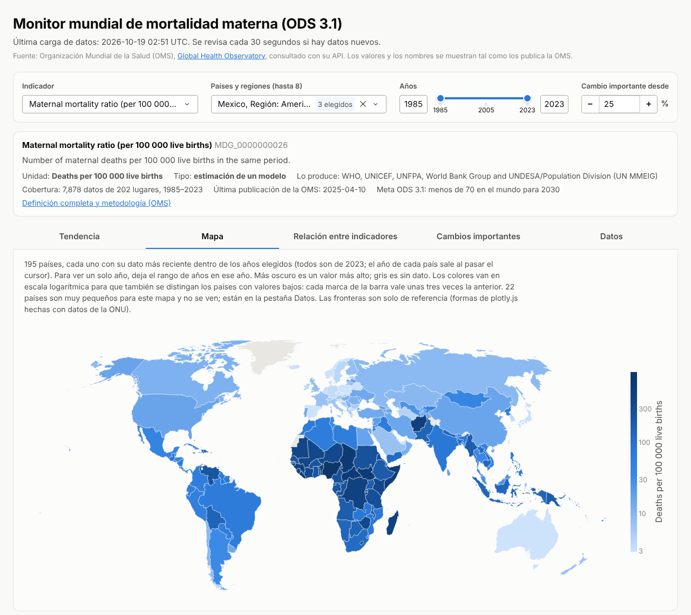
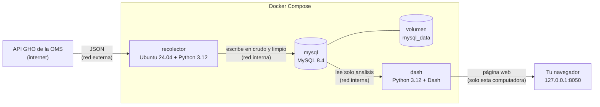
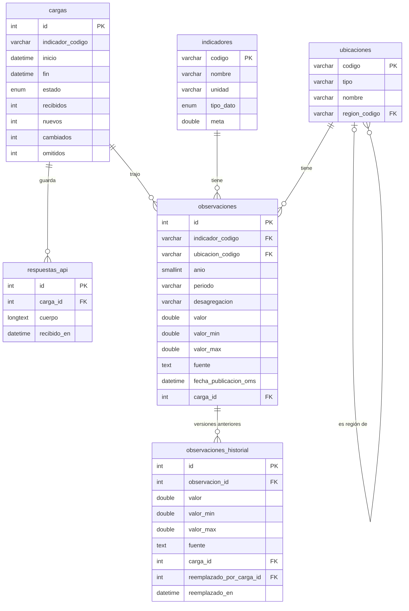

# Monitor mundial de mortalidad materna (ODS 3.1)

Prototipo con Docker que baja datos de la Organización Mundial de la Salud (OMS) con su API, los guarda en
MySQL y los muestra en una página web hecha con Dash. Sirve para ver cómo van México, América y el mundo hacia
la meta 3.1 de los Objetivos de Desarrollo Sostenible (ODS), y para comparar cualquier país sin perder de vista
qué tan seguro es cada dato.



## 1. La problemática

La meta 3.1 de los ODS pide que la razón de mortalidad materna del mundo baje a menos de 70 muertes por cada
100,000 nacidos vivos para 2030. Según la OMS, en 2023 el mundo estaba en 197.3 (rango de 174.5 a 234.0), casi
tres veces la meta. Bajó 40 % desde el año 2000, pero de 2015 a 2023 solo bajó 13 %, y para llegar a la meta
tendría que bajar casi dos tercios en siete años.

Las diferencias entre regiones son enormes: en 2023 África estaba en 442.1, América en 58.5 y Europa en 11.2.
México estaba en 42.1 (rango de 31.7 a 49.9). De 195 países, 78 seguían arriba de 70.

Los datos existen, pero no son fáciles de usar bien. La OMS los publica en una API que responde JSON, pensada
para programas y no para personas. La mortalidad materna es una estimación con un rango de incertidumbre: si los
rangos de dos países se enciman, no se puede decir que uno esté peor que el otro. En los datos de encuestas, un
cambio de fuente puede parecer una tendencia. Y cada ronda de estimaciones recalcula toda la serie.

Este proyecto junta los datos en un solo lugar, guarda la respuesta original para que cualquiera la procese a
su manera y los muestra siempre con su rango, su fuente y su año. La idea es que estudiantes, periodistas,
investigadores y personal de salud puedan comparar y descargar los datos sin llegar a conclusiones equivocadas.

## 2. La API y la información que trae

Los datos vienen de la API del Global Health Observatory (GHO) de la OMS. Es pública, no necesita clave y
responde en JSON con el formato OData. Su documentación está en la
[página de la OMS](https://www.who.int/data/gho/info/gho-odata-api).

El recolector pide tres catálogos de lugares (43 regiones, 234 países y el total mundial), el catálogo de
indicadores para revisar sus nombres y los datos de cada indicador que esté en el archivo `.env`:

| Código | Indicador (nombre de la OMS) | Tipo de dato | Qué trae |
|---|---|---|---|
| `MDG_0000000026` | Maternal mortality ratio (per 100 000 live births) | Estimación de un modelo | 7,878 registros: 195 países de 1985 a 2023, las 6 regiones de la OMS y el mundo, con rango de incertidumbre |
| `MDG_0000000025` | Births attended by skilled health personnel (%) | Dato reportado | 2,749 registros de 2000 a 2025: 193 países, las regiones y el mundo, con la fuente de cada dato |
| `WHS4_154` | Antenatal care coverage - at least four visits (%) | Dato reportado | 1,166 registros de 166 países, de 1990 a 2024, solo países. Se agrega en vivo en la demo |

Cada registro es el valor de un lugar en un año. Así llega el de México 2023 en mortalidad materna:

```json
{
  "Id": 2119248,
  "IndicatorCode": "MDG_0000000026",
  "SpatialDimType": "COUNTRY",
  "SpatialDim": "MEX",
  "ParentLocationCode": "AMR",
  "TimeDimType": "YEAR",
  "ParentLocation": "Americas",
  "Dim1Type": null,
  "Dim1": null,
  "TimeDim": 2023,
  "Dim2Type": null,
  "Dim2": null,
  "Dim3Type": null,
  "Dim3": null,
  "DataSourceDimType": null,
  "DataSourceDim": null,
  "Value": "42 [32-50]",
  "NumericValue": 42.10605109,
  "Low": 31.68329659,
  "High": 49.94773118,
  "Comments": null,
  "Date": "2025-04-10T15:44:11.957+02:00",
  "TimeDimensionValue": "2023",
  "TimeDimensionBegin": "2023-01-01T00:00:00+01:00",
  "TimeDimensionEnd": "2023-12-31T00:00:00+01:00"
}
```

`NumericValue` es el valor, `Low` y `High` son el rango de incertidumbre, `Comments` es la fuente (aquí viene
vacía porque es una estimación) y `Date` es cuándo lo publicó la OMS. Qué se guarda de cada campo está en el
[diccionario de datos](docs/diccionario_datos.md).

## 3. Arquitectura

Son tres contenedores que se levantan juntos con Docker Compose:



| Contenedor | Imagen | Qué hace |
|---|---|---|
| `recolector` (API-Ubuntu) | Ubuntu 24.04 con Python 3.12 | Consulta la API al arrancar y luego cada 24 horas. Guarda la respuesta tal cual, revisa cada registro y carga solo lo nuevo o lo que la OMS cambió. |
| `mysql` (BD) | MySQL 8.4 | Guarda los datos en tres capas. Los datos viven en el volumen `mysql_data`, así no se pierden al apagar. |
| `dash` (Python-Dash) | Python 3.12 slim con Dash y gunicorn | La página web. Solo lee las vistas de la base, nunca la API, y cada 30 segundos revisa si hay datos nuevos. |

Hay dos redes. La red interna no tiene salida a internet y en ella está MySQL, que no abre ningún puerto hacia
afuera. La red externa la usa el recolector para llegar a la API y el dashboard para que lo abras en tu
navegador, solo desde tu propia computadora (127.0.0.1).

También se cuidan estas cosas:

- Las contraseñas son secretos de Docker: archivos en `secrets/` que no se suben a Git. Cada contenedor recibe
  solo la suya.
- Cada programa entra a MySQL con un usuario que tiene lo mínimo: el recolector escribe en `crudo` y `limpio`, y
  el dashboard solo puede leer `analisis`.
- El recolector y el dashboard corren con un usuario sin privilegios. Las imágenes están fijadas por su huella
  (sha256) y las librerías van con versión exacta, así se arma siempre lo mismo que se probó.
- Los tres contenedores tienen healthcheck: MySQL arranca primero y los otros dos esperan a que esté listo.

## 4. Diseño de la base de datos

La base tiene tres capas, cada una en su propio esquema:

- `crudo` guarda cada consulta a la API (`cargas`) y la respuesta tal como llegó (`respuestas_api`). Si alguien
  quiere procesar los datos de otra forma, ahí está el original.
- `limpio` tiene los mismos valores de la OMS ordenados en tablas: `ubicaciones`, `indicadores`, `observaciones`
  y `observaciones_historial`. Ningún valor se cambia. Lo que no pasa las reglas de calidad se cuenta como
  omitido y se queda en `crudo`.
- `analisis` tiene las vistas que lee el dashboard.

En el diagrama van las columnas principales:



Una observación es única por indicador, lugar, desagregación y año, así que cargar dos veces no duplica nada.
Cuando la OMS corrige un valor, un trigger guarda la versión anterior en `observaciones_historial`.

| Vista | Para qué sirve |
|---|---|
| `v_series` | Cada dato junto al anterior de su serie, con el cambio en %, qué tan ancho es el rango y si cambió la fuente. |
| `v_ultimo_dato` | El dato más reciente de cada lugar, para el mapa. |
| `v_ubicaciones` | Países, regiones y mundo, con el nombre de su región. |
| `v_indicadores` | La ficha de cada indicador que ya tiene datos y qué tanto cubre. |
| `v_ultima_carga` | La última carga de cada indicador y cuándo salió bien por última vez. |

Todas las columnas, con su tipo y el campo de la API del que vienen, están en el
[diccionario de datos](docs/diccionario_datos.md).

## 5. Cómo se demuestra el flujo

Con todo levantado (abajo dice cómo), el camino de la API a la base de datos y de ahí a la página se ve así:

1. **Los tres contenedores funcionando.** `docker compose ps` los muestra como `healthy`.
2. **De la API a la base.** Se corre el recolector una vez:

   ```
   docker compose run --rm recolector --una-vez
   ```

   El log dice qué trajo de cada indicador, por ejemplo
   `MDG_0000000026: recibidos 7878, nuevos 0, cambiados 0, omitidos 0`. Nuevos 0 quiere decir que ya estaba todo
   y no se duplicó nada.
3. **Un indicador nuevo, en vivo.** En el archivo `.env` se agrega `WHS4_154` al final de `INDICADORES`
   (separado con una coma) y se vuelve a correr el mismo comando. Esta vez el log también muestra `WHS4_154` con
   lo que trajo.
4. **En la base.** Este script muestra los indicadores cargados y sus últimas cargas, y compara algunos datos
   con cifras revisadas a mano en la API. No cambia nada:

   ```
   cmd /c "docker compose exec -T mysql bash < mysql\revisar_datos.sh"
   ```

5. **En la página.** En http://127.0.0.1:8050, en menos de 30 segundos aparece el indicador nuevo en la lista,
   sin reiniciar nada. La página tiene cinco pestañas: Tendencia, Mapa, Relación entre indicadores, Cambios
   importantes y Datos, que también deja bajar los datos en CSV.

## Cómo correrlo en tu computadora

Necesitas Docker Desktop (en modo de contenedores Linux, que es el normal), Git e internet la primera vez. Si no
tienes Git, en GitHub puedes bajar el proyecto como ZIP con el botón Code.

En Windows, en PowerShell:

```
git clone https://github.com/victorhugo-data/oms-mortalidad-materna.git
cd oms-mortalidad-materna
Copy-Item .env.example .env
New-Item -ItemType Directory -Force secrets | Out-Null
foreach ($n in "mysql_root_password", "recolector_password", "dashboard_password") {
  Set-Content -Path "secrets\$n.txt" -Value ([guid]::NewGuid().ToString("N")) -NoNewline -Encoding ascii
}
docker compose up -d --build --wait
```

En Linux o Mac:

```
git clone https://github.com/victorhugo-data/oms-mortalidad-materna.git
cd oms-mortalidad-materna
cp .env.example .env
mkdir -p secrets
for n in mysql_root_password recolector_password dashboard_password; do openssl rand -hex 16 | tr -d '\n' > secrets/$n.txt; done
chmod 644 secrets/*.txt
docker compose up -d --build --wait
```

Después abre http://127.0.0.1:8050. La primera vez tarda unos minutos: baja las imágenes, arma los contenedores
y el recolector hace su primera carga. Las contraseñas se crean al azar en cada computadora y nadie tiene que
conocerlas. Se guardan sin salto de línea al final, porque contaría como parte de la contraseña.

## Comandos útiles

| Para | Comando |
|---|---|
| Ver cómo están los contenedores | `docker compose ps` |
| Ver lo que hace el recolector | `docker compose logs -f recolector` |
| Correr el recolector una vez | `docker compose run --rm recolector --una-vez` |
| Volver a armar todo después de cambiar el código | `docker compose up -d --build --wait` |
| Apagar todo (los datos se quedan) | `docker compose down` |
| Revisar que la base tenga sus esquemas, tablas, vistas y permisos | `cmd /c "docker compose exec -T mysql bash < mysql\revisar_base.sh"` |
| Revisar los datos contra cifras de la API | `cmd /c "docker compose exec -T mysql bash < mysql\revisar_datos.sh"` |
| Borrar todo, también la base | `docker compose down -v` |

Los comandos con `cmd /c` son para PowerShell, que no acepta `<`. En Linux o Mac se corre lo que va entre las
comillas, con `/` en lugar de `\`.

## Respaldo

Para sacar un respaldo de las tres capas (la carpeta `respaldos/` no se sube a Git; si no existe, créala con
`mkdir respaldos`):

```
cmd /c "docker compose exec -T mysql bash < mysql\respaldar.sh > respaldos\respaldo.sql"
```

Para cargarlo, por ejemplo en otra computadora que no tenga internet:

```
docker compose stop recolector
docker compose cp respaldos\respaldo.sql mysql:/tmp/respaldo.sql
cmd /c "docker compose exec -T mysql bash < mysql\restaurar.sh"
docker compose start recolector
```

El respaldo reemplaza los datos que haya. Los usuarios y las contraseñas de esa computadora no cambian.

## Avisos

- Los archivos de `secrets/` y de `mysql/init/` solo se usan cuando la base está vacía. Si cambias una
  contraseña o un SQL inicial después del primer arranque, la base no cambia: hay que borrar el volumen con
  `docker compose down -v`, que borra los datos (saca antes un respaldo).
- Si el puerto 8050 está ocupado, en `compose.yaml` cambia `"127.0.0.1:8050:8050"` por, por ejemplo,
  `"127.0.0.1:8051:8050"` y abre http://127.0.0.1:8051.
- En Linux, los archivos de `secrets/` tienen que poder leerse desde los contenedores (`chmod 644 secrets/*.txt`).
- `crudo` guarda la respuesta completa en cada carga: unos 7 MB por ciclo con dos indicadores, o unos 2.5 GB al
  año si corre todos los días.
- El mapa trae las formas de los países dentro del proyecto, así que funciona sin internet. 22 países muy
  pequeños no se ven en él, pero sí están en las tablas.
- Los nombres de países e indicadores van en inglés, como los publica la OMS. La página está en español.

## Mejoras futuras

- Guardar en `crudo` solo las respuestas que cambian, para que la base no crezca tanto.
- Usar migraciones para cambiar la base sin tener que borrar el volumen.
- Agregar el número de muertes maternas, si la API lo trae, para leer mejor a los países pequeños.

## Fuente de los datos

Organización Mundial de la Salud, Global Health Observatory (GHO), consultado con su API. Los datos se usan tal
como los publica la OMS.

Las cifras de mortalidad materna son estimaciones del grupo interinstitucional de la ONU: WHO, UNICEF, UNFPA,
World Bank Group y UNDESA/Population Division. *Trends in maternal mortality 2000 to 2023: estimates by WHO,
UNICEF, UNFPA, World Bank Group and UNDESA/Population Division*. Ginebra: Organización Mundial de la Salud; 2025.
[Página del informe](https://www.who.int/publications/i/item/9789240108462).

Las formas de los países del mapa son de [plotly.js](https://github.com/plotly/plotly.js) (licencia MIT), hechas
con datos geográficos de las Naciones Unidas.
